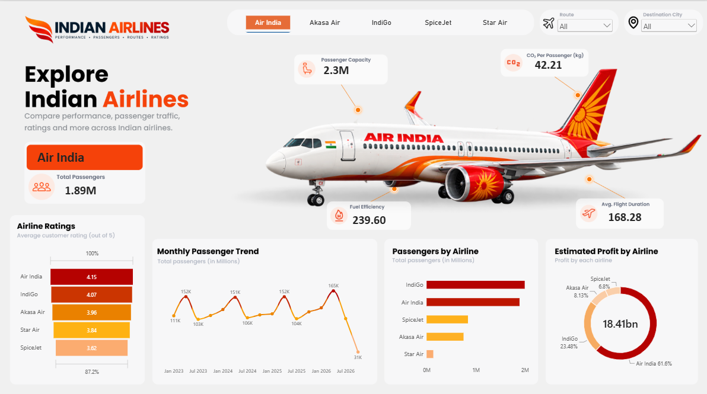

# Indian Airlines Performance & Operations Analysis Dashboard | Power BI

**🌟 Project Overview**

The Indian Airlines Performance & Operations Analysis Dashboard is a Power BI-based data analytics project designed to analyze airline performance, passenger traffic, flight operations, customer satisfaction, profitability, and environmental impact across major Indian airlines.

The dashboard transforms raw flight data into an interactive visual report, helping users compare airline performance, monitor passenger capacity, analyze customer ratings, evaluate estimated profitability, and understand operational efficiency across different airlines.

The dashboard covers five Indian airlines: Air India, IndiGo, Akasa Air, SpiceJet, and Star Air.

Interactive airline selection and slicers allow users to explore performance by Airline, Route, and Destination City. The dashboard also includes dynamic aircraft images that change according to the selected airline, providing a more interactive and visually engaging reporting experience.

**📊 Business Problem**

The aviation industry generates large amounts of operational and passenger data. Airlines need to monitor flight performance, passenger traffic, customer satisfaction, operational costs, and profitability to evaluate their overall business performance.

Analyzing raw flight data manually makes it difficult to compare airlines, identify passenger trends, evaluate customer ratings, understand flight delays, and monitor environmental impact.

This project addresses these challenges by presenting important airline performance metrics and interactive visualizations in a single Power BI dashboard, helping users explore operational and business performance across different airlines.

**🎯 Key Objectives**

1. Monitor overall airline performance using key performance indicators (KPIs).

2. Compare passenger traffic and passenger capacity across different airlines.

3. Analyze monthly passenger trends over time.

4. Evaluate customer ratings across major Indian airlines.

5. Compare passenger distribution among different airlines.

6. Analyze estimated profit performance across airlines.

7. Monitor CO₂ emissions per passenger to understand environmental impact.

8. Evaluate fuel efficiency across different airlines.

9. Analyze average flight duration and operational performance.

10. Enable interactive airline, route, and destination-based analysis.

11. Display dynamic aircraft images based on the selected airline.

**📁 Data Source**

**Source:** https://docs.google.com/spreadsheets/d/1TriuXB_lJrqNKSslbr3yX_qakeA7WsmT/edit?gid=1462792228#gid=1462792228

**Workbook Sheets:**

**1. Flight_Data**

Contains 40,000 flight records and 38 columns covering airline information, flight details, aircraft specifications, passenger data, operational performance, financial metrics, and environmental indicators.

**2. Aircraft_Images**

Contains 5 records and 5 columns with airline names, airline codes, aircraft display names, aircraft image URLs, and image alt text.

Airlines Covered:

- Air India

- IndiGo

- Akasa Air

- SpiceJet

- Star Air

**Analysis Period:** January 2023 - October 2026.

**📝 Tools and Technologies**

1. Microsoft Power BI Desktop - Dashboard development, data visualization, and interactive reporting.

2. Microsoft Excel - Source dataset containing flight information and aircraft image details.

3. Power Query - Data preparation and transformation.

4. DAX (Data Analysis Expressions) - Creating calculated measures and KPIs for airline performance analysis.

5. Data Modeling - Organizing flight and aircraft image data for interactive reporting.

6. Power BI Visualizations - KPI cards, line charts, bar charts, donut charts, and rating comparisons.

7. Power BI Slicers - Interactive filtering by Airline, Route, and Destination City.

8. Dynamic Image Display - Displaying airline-specific aircraft images using image URLs and DAX measures.

**🚀 Key Performance Indicators (KPIs)**

The dashboard highlights important performance indicators to evaluate airline operations and business performance.

1. **Passenger Capacity:** Represents the available passenger seating capacity across selected flight records.

2. **Total Passengers:** Measures the total number of passengers carried by the selected airline.

3. **CO₂ Per Passenger (kg):**  Measures estimated carbon emissions per passenger, helping compare the environmental impact of airline operations.

4. **Fuel Efficiency:** Represents the estimated fuel efficiency metric for selected airline operations.

5. **Average Flight Duration:** Measures the average flight duration across selected flight records.

**📈  Dashboard Visualizations**

The Indian Airlines dashboard provides an interactive overview of airline performance, passenger trends, customer ratings, estimated profitability, and operational metrics

**✅ Conclusion**

The Indian Airlines Performance & Operations Analysis Dashboard provides an interactive overview of airline performance across passenger traffic, customer ratings, estimated profitability, and operational efficiency.

By combining KPI monitoring, monthly passenger trends, airline comparisons, customer ratings, and environmental indicators, the dashboard helps users understand airline performance from multiple perspectives.

The project demonstrates how Power BI, Power Query, and DAX can transform raw flight data into meaningful visual insights and support data-driven analysis of the aviation industry.
